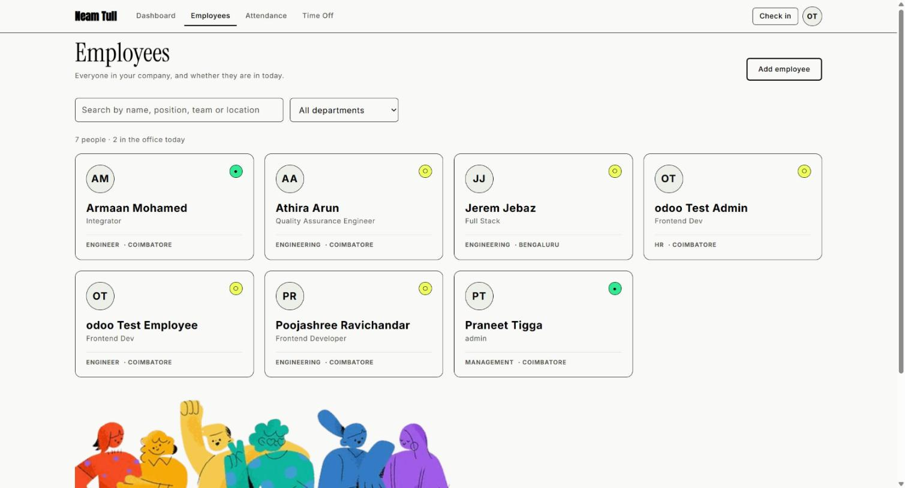
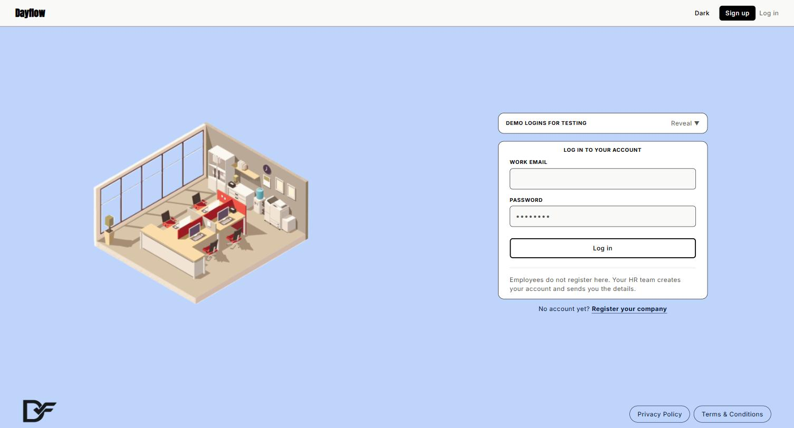
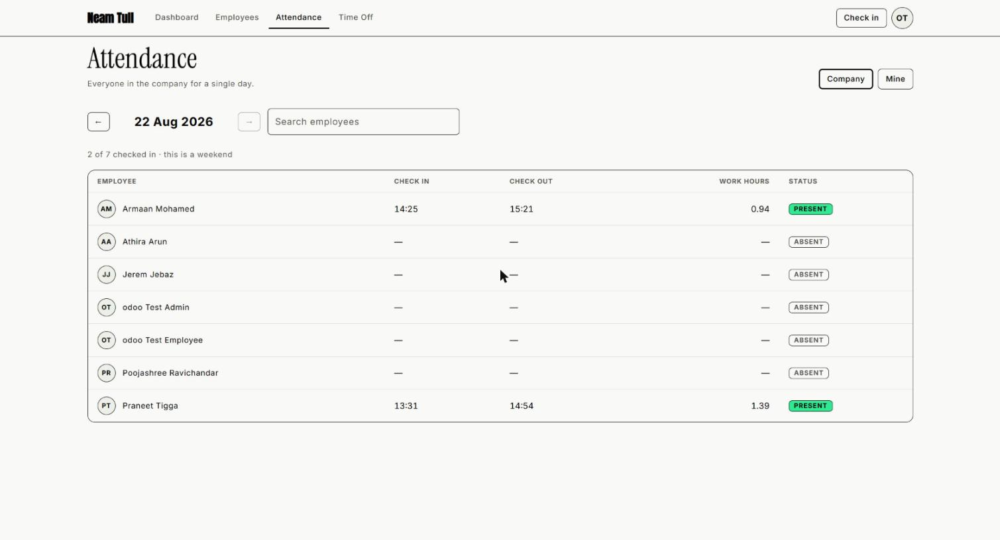
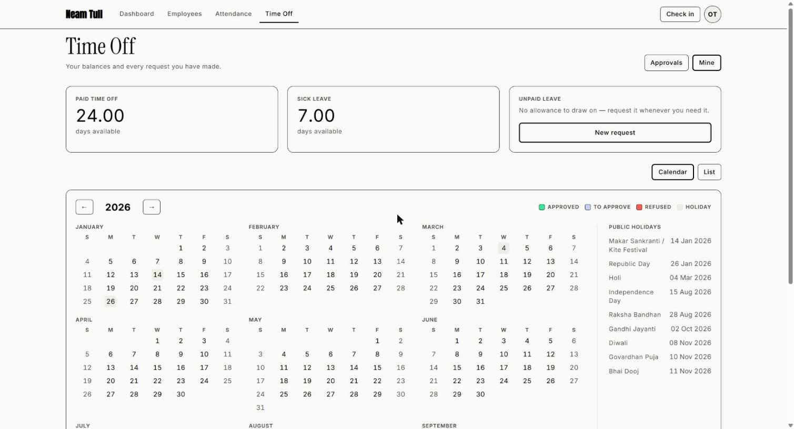
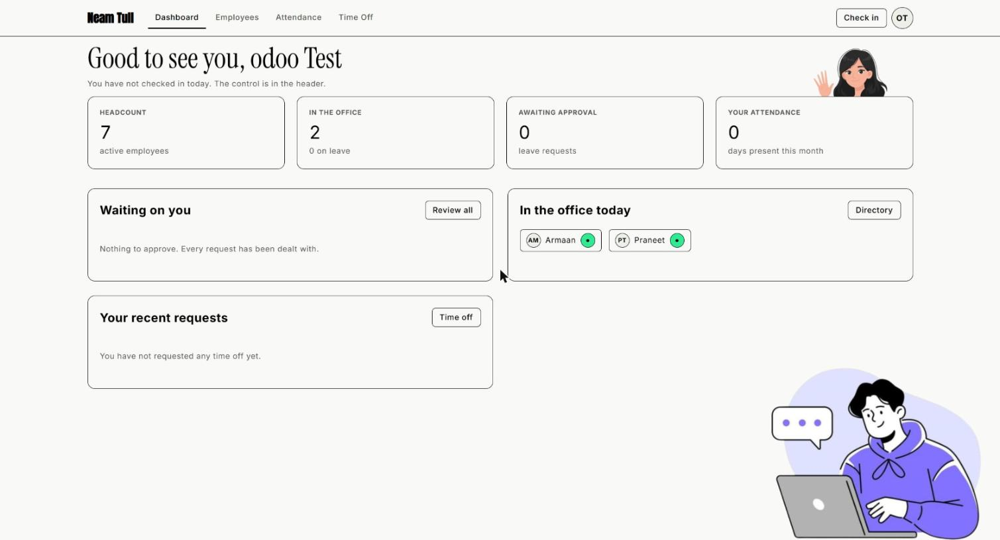

# Dayflow

### Every workday, perfectly aligned.

A human resource management system that keeps the four facts a company actually
runs on in one place, and makes them agree with each other: **who works here,
who showed up today, who is on leave, and what each person is owed at the end of
the month.**

A React frontend and a small TypeScript API over a single SQLite file. Runs on
your machine (see [Run it](#run-it)) or live at
**[dayflow-odoo-sand.vercel.app](https://dayflow-odoo-sand.vercel.app/)**, where
the demo database reseeds itself whenever the server cold-starts.



---

## Try it

Two seeded accounts. The sign-in page also carries a **"Demo logins for
testing"** panel that fills either one in a single click, so nothing here needs
retyping.

| Role | Email | Password |
|---|---|---|
|  | `odootestadmin@gmail.com` | `DayflowDemo7!` |
|  | `odootestemployee@gmail.com` | `DayflowDemo7!` |

Sign in as **admin** to see the whole company — every salary, the approval
queue, employee creation. Sign in as **employee** to see the same app from the
other side: own attendance, own leave, own salary, and nothing belonging to
anyone else. The difference between those two views is enforced by the API,
not in the interface.

> These are throwaway demo accounts holding seeded data. Delete them, and the
> reveal panel in `components/auth/DemoCredentials.tsx`, before this app ever
> holds real employee records.



---

## What it does

### The directory knows who is actually in

Every employee as a card, with a live presence indicator: 🟢 in the office,
✈️ on leave, 🟡 absent. It is **derived at read time** from attendance and
approved leave — there is no `status` column to go stale the moment somebody
checks in.

### Attendance is the register, not a log



Check in and out from the header. An employee sees their own month day by day
with derived work hours; Admin and HR see the entire company for any single day.
A gap covered by approved leave reads as **leave**, not as an absence — the
register and the directory never disagree about the same person.

### Time off, as a year at a glance



A full twelve-month calendar with approved, pending and rejected days colour
coded, public holidays alongside, and the same requests available as a list for
remarks, certificates and cancelling. Paid, sick and unpaid are separate;
approving a request moves the balance exactly once, inside one transaction.

### One wage in, the whole structure out

Type a monthly wage and the six components recompute live — Basic, HRA, standard
allowance, performance bonus, LTA, and a fixed allowance that **absorbs the
remainder so the components always total the wage to the paisa.** On ₹50,000:
Basic ₹25,000, HRA ₹12,500, gross exactly ₹50,000, net ₹46,800 after PF and
professional tax.

Admin and HR set it. An employee sees their own breakdown read-only and cannot
see anyone else's at all.

### A dashboard that answers the morning question



Headcount, who is in, what is waiting on you — or, as an employee, your own
attendance and remaining balances.

---

## Stack

**React 19 · TypeScript · Vite · Tailwind v4 · React Router v7 · Hono · SQLite**

The backend is a small TypeScript API on Node, using the built-in `node:sqlite`
module, so there is no database server to install. Locally, Vite proxies `/api`
to it; on Vercel, `scripts/build-vercel.mjs` bundles it into one function beside
the static frontend. Either way the browser sees a single origin.

## Architecture

```
frontend/src/
  components/ui/      shared primitives — every page builds from these
  components/layout/  app shell, header, nav
  pages/              one folder per screen
  services/           the only place the API is called
  lib/salary.ts       the salary engine — a pure function, no I/O
  lib/dates.ts        working-day maths, shared so counts cannot disagree
  context/            AuthProvider
  types/models.ts     row and view types, kept in step with the schema
backend/src/
  schema.sql          tables and constraints
  routes/             one file per domain — every access rule lives here
  auth.ts             passwords, sessions, request guards
  seed.ts             the demo company
backend/test/         access rules, exercised through the real routes
docs/
```

**Pages never call the API directly.** They call services; services call `/api`.
One person owns that boundary, which is what let four people build pages in
parallel without colliding on the data layer — and what let the backend be
replaced after the hackathon without touching a single page.

**Security lives in the API, not in route guards.** A guard hides a screen; it
does not stop a request. Every rule that matters — an employee cannot read a
colleague's salary, cannot edit their own role, cannot approve their own leave —
is checked by the server on every request, and the interface merely agrees with
it. Each rule has a test in `backend/test/api.test.ts`.

The salary engine is a pure function over a single wage, which is why the Salary
screen recomputes on every keystroke with no round-trip.

## Team

| | |
|---|---|
| **Armaan** | Integrator — `main`, design system, UI primitives, router, shell, deploy |
| **Praneet** | Backend — schema, API and access rules, seed data, services, types |
| **Pooja** | Pages, illustration and visual polish |
| **Athira** | Pages, auth surfaces and profile features |

---

<details open>
<summary><strong>Setup, demo data and checks</strong></summary>

### Run it

Needs **Node 24 or newer** (it runs the TypeScript backend directly and uses the
built-in SQLite module). Then, from the repo root:

```bash
npm run setup   # installs the root, backend and frontend packages
npm run dev     # API on :8787 and the app on http://localhost:5173
```

No environment variables or keys are needed. On first run the API creates
`backend/data/dayflow.db` and seeds the demo company. Uploaded avatars, logos
and leave documents go in `backend/uploads/`. Both folders are gitignored.

```bash
npm run db:reset   # delete the database and uploads, and reseed
```

### Demo data

Company **Neam Tull**. Every seeded account uses the password `DayflowDemo7!`.

| role | employee | email | position | department |
|---|---|---|---|---|
| Admin | Meera Krishnan | `odootestadmin@gmail.com` | HR Manager | Human Resources |
| Employee | Rahul Menon | `odootestemployee@gmail.com` | Backend Developer | Engineering |
| Admin | Praneet Tigga | `praneettigga@gmail.com` | admin | management |
| Employee | Armaan Mohamed | `amohamed@karunya.edu.in` | Integrator | Engineering |
| Employee | Poojashree Ravichandar | `poojashree@karunya.edu.in` | Frontend Developer | Engineering |
| Employee | Athira Arun | `athiraarun@karunya.edu.in` | Quality Assurance Engineer | Engineering |

Attendance covers this month's weekdays up to today. Four people are checked in
today; Athira and Rahul are not, so the directory shows every presence state and
the employee demo account can try checking in. Two requests are pending.

Registering a new company on the sign-up page signs you straight in — there is
no email confirmation. Employees you add through the app get a one-time
temporary password, which they replace at first sign-in.

### Checks

```bash
npm test        # API access-rule tests + the salary engine test
npm run check   # backend typecheck, frontend lint, frontend build
```

### Docs

`docs/HACKATHON_PLAN.md` is the operating manual. `docs/SCHEMA.md`,
`docs/AUTH.md` and `docs/SERVICES.md` are the data contract — if something is
not in them, it does not exist. `docs/BUILD_RULES.md` goes into your local,
gitignored `CLAUDE.md` before you run an AI session on this repo.

</details>
